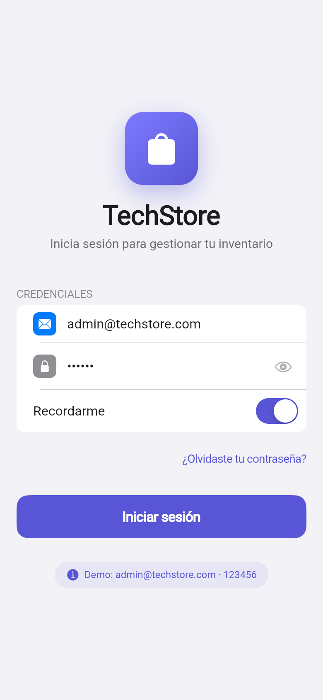
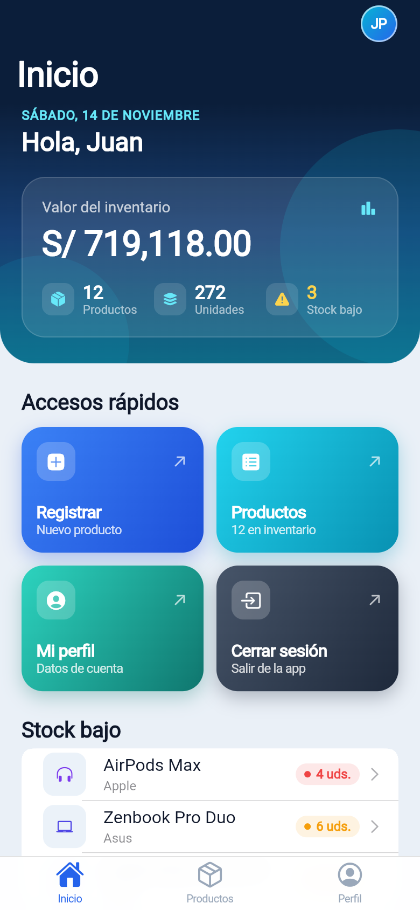
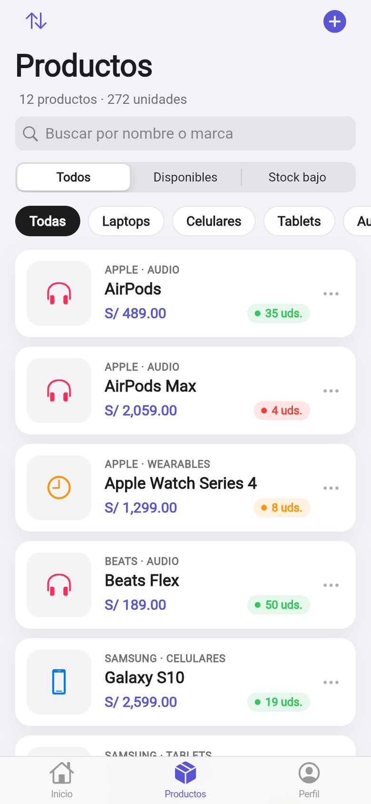
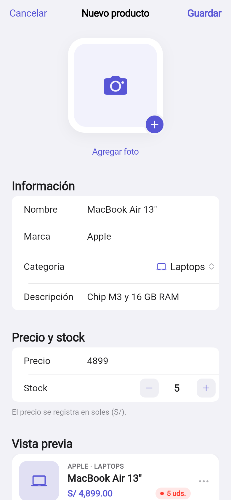
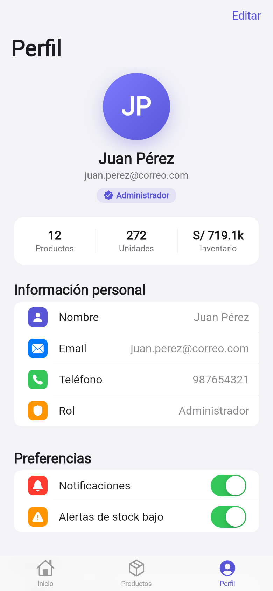

# TechStore · Laboratorio S11-12 (Cupertino)

**Alumno:** Pablo Isla Arone · TECSUP, Diseño y Desarrollo de Software

Continuación del laboratorio de la semana 8 ([lab_07-08_Multi](https://github.com/pabloislaarone/lab_07-08_Multi)). Es la misma app de inventario (Login, Menú, Listar productos, Registrar producto y Perfil), pero ahora hecha con widgets **Cupertino**, así que se ve y se comporta como una app de iOS.

**Usuario de prueba:** `admin@techstore.com` / `123456`

## Cómo iniciarlo

### Opción 1: sin instalar nada (DartPad)
1. Entra a [dartpad.dev](https://dartpad.dev).
2. Copia todo el contenido de [`dartpad/main.dart`](dartpad/main.dart) (es el proyecto completo en un solo archivo) y pégalo en el editor.
3. Presiona **Run** y entra con el usuario de prueba.

### Opción 2: en VS Code con Flutter instalado
Necesitas Flutter 3.27 o superior y las extensiones **Flutter** y **Dart** en VS Code.

```bash
git clone https://github.com/pabloislaarone/lab_11-12_Multi.git
cd lab_11-12_Multi
flutter create . --project-name techstore_app   # genera android/, ios/, web/ sin tocar lib/
flutter pub get
flutter run -d chrome                            # o "flutter run" con un emulador abierto
```

En VS Code también puedes abrir la carpeta, elegir el dispositivo abajo a la derecha y presionar **F5**.

## Estructura del proyecto

```
lib/
├── main.dart                         # Arranca la app (CupertinoApp)
├── routes/app_routes.dart            # Rutas, apertura de formularios y cierre de sesión
├── theme/app_theme.dart              # Colores, textos y tema Cupertino
├── models/                           # Producto y Usuario
├── data/app_data.dart                # Productos, usuario y operaciones (agregar, editar, eliminar)
├── widgets/                          # Piezas reutilizables (foto, fila de producto, avisos...)
└── screens/
    ├── login_screen.dart             # 1. Login
    ├── home_screen.dart              # Barra de pestañas: Inicio, Productos y Perfil
    ├── menu_screen.dart              # 2. Menú (pestaña Inicio)
    ├── listar_productos_screen.dart  # 3. Listar productos
    ├── detalle_producto_screen.dart  #    Detalle de un producto
    ├── registrar_producto_screen.dart# 4. Registrar / editar producto
    ├── perfil_screen.dart            # 5. Perfil
    └── editar_perfil_screen.dart     #    Editar perfil
test/widget_test.dart                 # Prueba: login con la cuenta demo
dartpad/main.dart                     # Todo el proyecto en un archivo para DartPad
docs/capturas/                        # Capturas de la app
```

## Capturas

| 1. Login | 2. Menú | 3. Listar productos | 4. Registrar producto | 5. Perfil |
|:---:|:---:|:---:|:---:|:---:|
|  |  |  |  |  |
